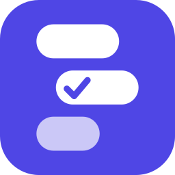

<p align="center">
  
</p>

<h1 align="center">Stackpad</h1>

<p align="center">
  A block-based note app for Android. Mix text, lists, checklists, images, tables, voice notes, links and prompts in one note.
</p>

<p align="center">
  <a href="https://github.com/mastah123/stackpad/actions/workflows/android.yml"></a>
  
  
  
  
</p>

## Features

Every note is a stack of compact blocks, laid out tightly like chat messages.

| Block | What it does |
| --- | --- |
| **Text** | One line per block, so each line can be H1, H2, H3 or normal. **Bold**, *italic*, underline. URLs are highlighted and open when tapped. |
| **List** (menu) | **Bullets**, **Numbers** and **Letters**: long items wrap under the text, never under the marker. **Checklist**: rounded card with a progress tracker, drag handles to reorder, a sort button (done items last), due dates with reminder notifications, and an "x" to remove it. |
| **Image** | Full width, from the gallery or camera. Tap for full-screen zoom, add a caption, or remove it with the "x". |
| **Table** | Small spreadsheet with `+ - * /`, parentheses, cell references such as `=A1+B1*2`, and `SUM`, `AVERAGE`, `MIN`, `MAX`, `COUNT` over ranges such as `=SUM(A1:A5)`. |
| **Audio** | Voice-message style row: play, animated waveform you can tap or drag to seek, duration, 1x / 1.5x / 2x speed, and "x". Recorded in app. |
| **Link** | Title and URL with validation; opens in the browser. |
| **Cards** (menu) | **Prompt**: monospace card with a one-tap copy button. **Quote**: indented italic quotation with an accent bar. **Code**: monospace block with a copy button. |
| **Divider** | A horizontal rule between parts of a note. |

Also:

- **Side menu** (top-left) with shortcuts for All notes, Pinned, Folders (small grid), Tags (scrolling row), Trash and Settings.
- **Share** a note as Markdown or plain text, or **copy** it whole, from the editor's 3-dot menu, which also holds the note options (folder, tags, color).
- **Templates**: start from Meeting notes, To-do, Journal or Project plan, or save any note as your own template.
- **Select blocks** to copy them as text or move them up and down, or copy the whole note.
- **Lock a single note** behind your screen lock, even with app lock off.
- **Backup and restore**: export every note with its images and audio to a zip, and merge it back later without overwriting newer edits.
- **App lock** with your fingerprint, face or screen lock, plus a hidden preview in recent apps.
- **Home-screen widget** with a new-note button and your latest note.
- **Undo / redo** in the editor.
- **Folders**, **tags** and **colors** to organize notes, with filters in the note list.
- **Trash** with restore; notes are erased after 30 days.
- **Sort** by last edited, date created or title.
- Note list with word-based **search** (highlighted matches, filters by folder, tag and color), **pin**, and **multi-select** (long-press) to pin, file, tag or trash several notes at once, autosave, and a light/dark theme that follows the system by default with a manual override.

## Tech stack

- Kotlin, Jetpack Compose (Material 3)
- Room for local storage, DataStore for settings
- kotlinx.serialization for block content
- Coil for images, MediaRecorder / MediaPlayer for audio
- GitHub Actions for CI and release signing

All data stays on the device. There is no account, no cloud sync and no analytics.

## Architecture

```
app/src/main/java/com/stackpad/app/
├── data/            Room database, repository, media files, settings
│   ├── model/       Block types and note models
│   ├── db/          Entities, DAOs, database and migrations
│   ├── media/       Image and audio file storage
│   ├── backup/      Backup file models and the zip export/restore
│   └── prefs/       Theme, sort and security preferences
├── domain/          Pure Kotlin logic (unit tested)
│   ├── backup/      Backup format rules and merge decision
│   ├── export/      Markdown and plain-text note export
│   ├── formula/     Spreadsheet formula evaluator
│   ├── history/     Undo/redo stacks
│   ├── image/       Zoom and pan limits
│   ├── reminders/   Due dates and reminder planning
│   ├── notes/       Sorting, filtering, tags, folder names, trash policy
│   ├── security/    When the app lock re-locks
│   ├── sheet/       Table edit operations
│   ├── templates/   Built-in templates and template rules
│   └── text/        Span editing, URL detection, list markers
├── audio/           Recorder, player, playback speed, waveform helpers
├── notifications/   Reminder alarms and notifications
├── security/        App lock controller and device credential check
├── widget/          Home-screen widget
├── ui/
│   ├── theme/       Colors, compact typography
│   ├── components/  Shared widgets
│   ├── notes/       Note list screen, side menu, filters, sort
│   ├── trash/       Trash screen
│   ├── settings/    Backup, restore, app lock and about
│   ├── lock/        Lock screen
│   ├── editor/      Editor screen, toolbars, one view per block type
│   └── navigation/
└── util/            Formatting and intent helpers
```

Each block type has its own view file and its own pure logic, so a block can change without touching the others.

## Build

Requirements: JDK 17 and the Android SDK (Android Studio sets this up).

```bash
./gradlew testDebugUnitTest   # unit tests
./gradlew assembleDebug       # debug APK in app/build/outputs/apk/debug/
```

The app version lives in `gradle.properties` (`VERSION_NAME`, `VERSION_CODE`).

### CI and releases

`.github/workflows/android.yml` runs on every push and pull request to `master`. It runs the unit tests, builds a debug APK, and uploads it as a workflow artifact. When the signing secrets exist, it also builds a signed release APK and AAB.

To enable signed builds, add four repository secrets. Step-by-step instructions are in [docs/SIGNING.md](docs/SIGNING.md). No secret is ever stored in the repository.

## Testing

Unit tests cover the formula evaluator, span editing, URL handling, list markers, table operations, waveform helpers, block serialization, table functions, due dates and reminder planning, image zoom limits, audio speed, note sorting and filtering, tags, trash timing, undo history, note export, backup rules and app-lock timing. A manual checklist for everything else (UI, audio, camera) is in [docs/TESTING.md](docs/TESTING.md).

## Known limitations

- Auto-capitalization uses the keyboard's own setting, so it depends on your keyboard app.
- Backspace-at-start merging relies on the keyboard sending a delete key event, which most keyboards do.
- Inline links are detected automatically from typed or pasted URLs. Tapping a link opens it, so to edit a link, tap just outside it.
- Undo and redo cover the title and blocks, not pinning, folder, tags or color. History is cleared when you leave the note.
- Table functions are `SUM`, `AVERAGE`, `MIN`, `MAX` and `COUNT`. There is no `IF`, text or date handling.
- Due dates are whole days. Reminders fire at 9:00 and may arrive a little late when the phone is idle (inexact alarms), and nothing is shown if notifications are off for the app.
- Notes are local only; uninstalling the app deletes them unless you exported a backup. Backups are not encrypted, so keep the zip somewhere safe. Restoring adds and updates notes but never deletes any, and a note deleted on this phone comes back if it is in the backup.
- Note lock and app lock use the phone's screen lock to gate the app. They do not encrypt notes on disk, and backups are not encrypted either, so a locked note's content is readable in a backup file.
- Whole blocks are reordered with move up and move down buttons (no drag and drop between blocks; checklist items can be dragged). Block selection copies whole blocks; selecting a range of characters across blocks is not possible.
- App lock uses the phone's screen lock. If that lock is removed from the phone, app lock turns itself off. It locks again after 30 seconds in the background. It does not encrypt the notes on disk.
- The widget shows the most recently edited note and refreshes when you leave the app and about every 30 minutes.
- Recording stops automatically after 10 minutes.

## License

[MIT](LICENSE)
