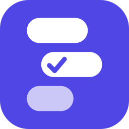

<p align="center">
  
</p>

<h1 align="center">Stackpad</h1>

<p align="center">
  A block-based note app for Android. Mix text, lists, checklists, images, tables, voice notes, links and prompts in one note.
</p>

<p align="center">
  <a href="https://github.com/mastah123/stackpad/actions/workflows/android.yml"></a>
  
  
  
  
</p>

## Features

Every note is a stack of compact blocks, laid out tightly like chat messages.

| Block | What it does |
| --- | --- |
| **Text** | One line per block, so each line can be H1, H2, H3 or normal. **Bold**, *italic*, underline. URLs are highlighted and open when tapped. |
| **List** (menu) | **Bullets**, **Numbers** and **Letters**: long items wrap under the text, never under the marker. **Checklist**: rounded card with a progress tracker, drag handles to reorder, a percentage, due dates with reminder notifications (overdue dates are highlighted), and an "x" to remove it. The checklist menu has **Auto-sort done items** (animated), **Hide completed** (with a "N done" line), **Done items to the bottom**, **Sort by due date**, **Uncheck all** and **Delete completed**; Uncheck all and Delete completed offer Undo. |
| **Image** (+ menu) | Full width, from the gallery or camera. Tap for full-screen zoom, edit it (crop, rotate, flip, straighten, restore original), or remove it with the "x". |
| **Table** (+ menu) | Small spreadsheet with `+ - * /`, parentheses, cell references such as `=A1+B1*2`, and `SUM`, `AVERAGE`, `MIN`, `MAX`, `COUNT` over ranges such as `=SUM(A1:A5)`. The table menu **imports a CSV file** (comma, semicolon or tab separated; replaces the table, with Undo) and **exports the table as a CSV** you can share (formulas are exported as their results). |
| **Audio** (+ menu) | Voice-message style row: play, animated waveform you can tap or drag to seek, duration, 1x / 1.5x / 2x speed, and "x". Recorded in app. |
| **Link** (+ menu) | Title and URL with validation; opens in the browser. |
| **Cards** (menu) | **Prompt**: monospace card with a one-tap copy button. **Quote**: indented italic quotation with an accent bar. **Code**: monospace block with a copy button. |
| **Divider** (+ menu) | A horizontal rule between parts of a note. |

Also:

- **Side menu** (top-left) with shortcuts for All notes, Pinned, Folders (small grid), Tags (scrolling row), Trash and Settings.
- **Import from Google Keep**: Settings > Import > Google Keep, then choose the Takeout `.zip` (export Keep from takeout.google.com). Text and list notes, labels (as tags), colors, pinned state, links, pictures and dates are imported; importing the same zip again adds nothing new. Audio and drawing attachments and notes in Keep's trash are skipped.
- **More imports** (Settings > Import): Markdown and text files or zips (also Obsidian and Notion exports), Evernote `.enex`, Word `.docx` and PDF. Several files can be picked at once and importing the same file again adds nothing new. PDF text is a best-effort reading (PDFs store no structure); a scanned PDF becomes a note with its pages as pictures.
- **Share** from the editor's 3-dot menu: copy, plain text, Markdown, a single **image** (PNG, saved to your gallery in Pictures/Stackpad, then shared) or a **PDF** (saved where you choose, then shared). Image and PDF copy the note's layout: the app's text sizes, list markers, full-width pictures, block colors, checklist cards with progress, and table grids, without any buttons or handles. **Share options** (a sheet before sharing, with "Don't show this again" and a Share options row in the menu) let you pick a light, dark or match-app page, note color, text size, PDF page size and page numbers, hide completed tasks or pictures, leave out empty lines, list items, checklists, tables and cards, and add the title, word count, dates, tags or a footer. The same menu sets the note **color**.
- **Tags** are added from the Tag chip in the add bar (tap a tag to add or remove it, "+" creates one); tags show above the title and tap to remove.
- **Text runs**: plain text lines live in one block, so you can select and copy many lines at once. Any line can be a heading (H1 to H3). A table, list, picture or card ends a run: text, then a table, then text is three blocks. Inserting a block in the middle of text splits it at the cursor, and removing a block between two texts joins them. In block selection, "Select everything between" fills the gap between the first and last selected block.
- **Share into Stackpad**: choose Stackpad in another app's share menu to save text, links or pictures as a new note (web addresses become link cards; a shared page title becomes the note title).
- **Export all notes as Markdown** (Settings): one zip with a `.md` file per note, a folder per Stackpad folder and a shared `media/` folder with pictures. Locked and trashed notes are left out; audio is not included.
- **Automatic backup** (Settings): pick a folder and a daily or weekly schedule; Stackpad writes `stackpad-auto-<date>.zip` there and keeps the last 7. "Back up now" runs it on demand. Android decides the exact time, and backups are not encrypted.
- The add bar groups blocks: **+** (image, camera, audio, link, table, divider), Text, List, Cards, Tag.
- **Templates**: start from Meeting notes, To-do, Journal or Project plan, or save any note as your own template.
- **Select blocks** to copy them as text or move them up and down, or copy the whole note.
- **Lock a single note** behind your screen lock, even with app lock off.
- **Backup and restore**: export every note with its images and audio to a zip, and merge it back later without overwriting newer edits.
- **App lock** with your fingerprint, face or screen lock, plus a hidden preview in recent apps.
- **Home-screen widget** with a new-note button and your latest note.
- **Undo / redo** in the editor.
- **List or grid**: a button in the note list switches between a list and a two-column staggered grid (remembered). Note cards show a **formatted preview** of the start of each note (headings, bold, lists, checklists, quotes, code, tables, audio and a small picture), cut off with a fade. Pictures use small cached thumbnails so scrolling stays smooth.
- A small faded line under the editor title shows the **word count** and when the note was created.
- Cards have colors that match their job: checklist green, table teal, link blue, prompt purple, quote amber, code slate, audio rose.
- **Folders** (managed from the note list; rename and delete are icons in the top bar when a folder is selected; a new note made while a folder is selected goes into it), **tags** and **colors** to organize notes, with filters in the note list.
- **Trash** with restore; notes are erased after 30 days.
- **Sort** by last edited, date created or title.
- Note list with word-based **search** (highlighted matches, filters by folder, tag and color), **pin**, and **multi-select** (long-press) to pin, file, tag or trash several notes at once, autosave, and a light/dark theme that follows the system by default with a manual override.

## Tech stack

- Kotlin, Jetpack Compose (Material 3)
- Room for local storage, DataStore for settings
- kotlinx.serialization for block content
- Coil for images, MediaRecorder / MediaPlayer for audio
- GitHub Actions for CI and release signing

All data stays on the device. There is no account, no cloud sync and no analytics.

## Architecture

```
app/src/main/java/com/stackpad/app/
├── data/            Room database, repository, media files, settings
│   ├── model/       Block types and note models
│   ├── db/          Entities, DAOs, database and migrations
│   ├── media/       Image and audio file storage
│   ├── backup/      Backup file models and the zip export/restore
│   └── prefs/       Theme, sort and security preferences
├── domain/          Pure Kotlin logic (unit tested)
│   ├── backup/      Backup format rules and merge decision
│   ├── export/      Markdown and plain-text note export
│   ├── formula/     Spreadsheet formula evaluator
│   ├── history/     Undo/redo stacks
│   ├── image/       Zoom and pan limits, picture editing maths (crop, rotate, flip, straighten)
│   ├── reminders/   Due dates and reminder planning
│   ├── notes/       Sorting, filtering, tags, folder names, trash policy
│   ├── security/    When the app lock re-locks
│   ├── sheet/       Table edit operations
│   ├── templates/   Built-in templates and template rules
│   └── text/        Span editing, URL detection, list markers
├── audio/           Recorder, player, playback speed, waveform helpers
├── notifications/   Reminder alarms and notifications
├── security/        App lock controller and device credential check
├── widget/          Home-screen widget
├── ui/
│   ├── theme/       Colors, compact typography
│   ├── components/  Shared widgets
│   ├── notes/       Note list screen, side menu, filters, sort
│   ├── trash/       Trash screen
│   ├── settings/    Backup, restore, app lock and about
│   ├── lock/        Lock screen
│   ├── editor/      Editor screen, toolbars, one view per block type
│   └── navigation/
└── util/            Formatting and intent helpers
```

Each block type has its own view file and its own pure logic, so a block can change without touching the others.

## Build

Requirements: JDK 17 and the Android SDK (Android Studio sets this up).

```bash
./gradlew testDebugUnitTest   # unit tests
./gradlew assembleDebug       # debug APK in app/build/outputs/apk/debug/
```

The app version lives in `gradle.properties` (`VERSION_NAME`, `VERSION_CODE`).

### CI and releases

`.github/workflows/android.yml` runs on every push and pull request to `master`. It runs the unit tests, builds a debug APK, and uploads it as a workflow artifact. When the signing secrets exist, it also builds a signed release APK and AAB.

To enable signed builds, add four repository secrets. Step-by-step instructions are in [docs/SIGNING.md](docs/SIGNING.md). No secret is ever stored in the repository.

## Testing

Unit tests cover the formula evaluator, span editing, URL handling, list markers, table operations, waveform helpers, block serialization, table functions, due dates and reminder planning, image zoom limits, audio speed, note sorting and filtering, tags, trash timing, undo history, word counting, note previews, picture editing maths, Keep import rules, Markdown, Evernote, Word and PDF import parsing, CSV reading and writing, text runs and line headings, share-in planning, Markdown archive naming, backup retention, checklist sorting and counting, note export (text, image/PDF layout and pagination), backup rules and app-lock timing. A manual checklist for everything else (UI, audio, camera) is in [docs/TESTING.md](docs/TESTING.md).

## Known limitations

- Auto-capitalization uses the keyboard's own setting, so it depends on your keyboard app.
- Backspace-at-start merging relies on the keyboard sending a delete key event, which most keyboards do.
- Inline links are detected automatically from typed or pasted URLs. Tapping a link opens it, so to edit a link, tap just outside it.
- Undo and redo cover the title and blocks, not pinning, folder, tags or color. History is cleared when you leave the note.
- Table functions are `SUM`, `AVERAGE`, `MIN`, `MAX` and `COUNT`. There is no `IF`, text or date handling.
- Due dates are whole days. Reminders fire at 9:00 and may arrive a little late when the phone is idle (inexact alarms), and nothing is shown if notifications are off for the app.
- Notes are local only; uninstalling the app deletes them unless you exported a backup. Backups are not encrypted, so keep the zip somewhere safe. Restoring adds and updates notes but never deletes any, and a note deleted on this phone comes back if it is in the backup.
- Note lock and app lock use the phone's screen lock to gate the app. They do not encrypt notes on disk, and backups are not encrypted either, so a locked note's content is readable in a backup file.
- Whole blocks are reordered with move up and move down buttons (no drag and drop between blocks; checklist items can be dragged). Block selection copies whole blocks; dragging a text selection across a table or list is not possible (select the blocks instead).
- App lock uses the phone's screen lock. If that lock is removed from the phone, app lock turns itself off. It locks again after 30 seconds in the background. It does not encrypt the notes on disk.
- The widget shows the most recently edited note and refreshes when you leave the app and about every 30 minutes.
- Recording stops automatically after 10 minutes.

## License

[MIT](LICENSE)

PDF import uses [PdfBox-Android](https://github.com/TomRoush/PdfBox-Android) (Apache License 2.0).
